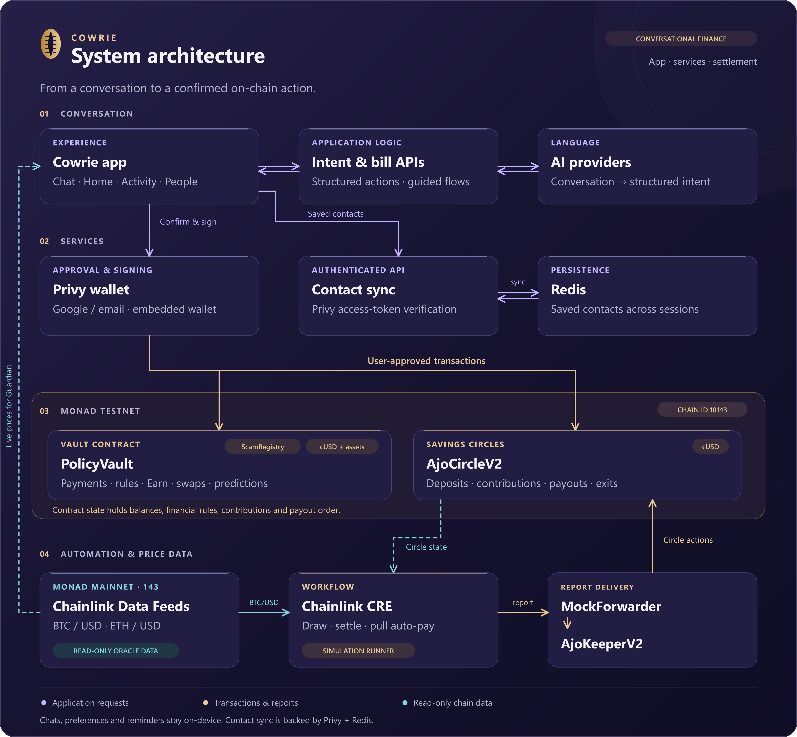

<p align="center">
  <a href="https://cowrie-amber.vercel.app"></a>
</p>

<p align="center">
  <a href="#deployed-on-monad-testnet"></a>
  <a href="contracts/"></a>
  <a href="web/app/"></a>
  <a href="scripts/"></a>
  <a href="web/app/globals.css"></a>
  <a href="web/"></a>
  <a href="hardhat.config.js"></a>
  <a href="cowrie-cre/README.md"></a>
  <a href="LICENSE"></a>
  <a href="CONTRIBUTING.md"></a>
</p>

<p align="center">
  <a href="https://cowrie-amber.vercel.app">Try Cowrie</a> ·
  <a href="https://cowrie-amber.vercel.app/demo">Watch the demo</a> ·
  <a href="#what-you-can-do-today">Capabilities</a> ·
  <a href="#architecture">Architecture</a> ·
  <a href="#what-each-integration-does">Integrations</a> ·
  <a href="#run-the-web-app">Local setup</a> ·
  <a href="#deployed-on-monad-testnet">Contracts</a> ·
  <a href="docs/ATTRIBUTIONS.md">Attribution</a>
</p>

# Cowrie

Cowrie is a conversational wallet for everyday finance and DeFi. The ambition is to bring the entire crypto stack behind a simple prompt, starting with everyday Nigerians and expanding to people worldwide. Monad provides the fast settlement layer for the transactions behind that conversation.

You describe what you want in your own words. The AI uses the conversation and your wallet context to interpret the request, explain available options and ask for missing details. Supported actions flow through your wallet to contracts on Monad. Today's app covers payments, savings, token swaps and shared savings circles, with more of the crypto stack to follow.

Cowrie is built first for everyday use in Nigeria. It defaults to naira, understands Nigerian Pidgin and supports Igbo, Yoruba and Hausa alongside other languages. Google or email sign-in creates an embedded wallet through Privy, with gas sponsorship requested for transactions.

**The [live app](https://cowrie-amber.vercel.app) runs on Monad testnet with cUSD test money.** Displayed naira amounts use demo conversion rates. Bill payments simulate service delivery, and the savings yield and traded assets are test tokens.

## Watch Cowrie

- [Product tour](web/public/demos/cowrie-product-v1.mp4) — payments, savings and Ajo through conversation.
- [Ajo and Chainlink CRE](web/public/demos/cowrie-cre-v1.mp4) — a recorded testnet circle, from the draw and automatic contributions to both payouts.

Both videos are available on the app's `/demo` page. The CRE walkthrough uses test cUSD and CRE simulation with broadcast. Its transaction evidence is in [the verification record](docs/demos/cre-verification.json).

## Why Nigeria first

Cowrie's growth strategy is to establish demand in Nigeria and expand from that foundation. Starting with a focused community gives the product a place to be tested against everyday financial needs and improved through direct feedback. The aim is to build a wallet people keep using at home, then carry what works into other markets.

The people using Cowrie will shape its defining features and development priorities. Support for additional languages and display currencies already makes room for users beyond Nigeria. Feedback from each new market will also guide how the wallet adapts to local needs.

## What you can do today

You can start with a question or an everyday goal, then work through the details in conversation. These examples illustrate how Cowrie uses context:

| A conversation | What the AI handles |
|---|---|
| "How does Earn work?" Then: "Put 20,000 naira there." | Explain the feature first, then use the earlier conversation to interpret "there" as the demo Earn vault and prepare the deposit. |
| "Whenever money comes in, tuck away a tenth of it so I don't spend everything." | Interpret the savings goal and the fraction, then prepare a 10% auto-save rule for incoming vault credits. |
| During an airtime payment: "Abeg, I picked the wrong network. Let me change am." | Understand the correction in the context of the current bill flow and return to the network choice. |
| "Did I already send Mum the money?" | Use the recent wallet activity and conversation supplied to the assistant to answer a question about a previous payment. |

The current testnet app supports the following actions:

| Area | Available today |
|---|---|
| Payments and contacts | Send cUSD to saved contacts. Incoming payments appear in history and trigger an in-app notice. |
| Requests and bill splitting | Prepare payment requests or divide a shared amount between payers. |
| Auto-save and spending limits | Set a percentage of incoming vault credits to save and a daily cap on vault sends, enforced by `PolicyVault`. |
| Allowances | Set a streaming allowance that the recipient claims as it accrues. |
| Earn, swaps and predictions | Move funds into the demo Earn vault, trade cBTC/cETH/cGOLD in contract pools, or take a side in a prediction market. |
| Guided bill payments | Work through electricity, airtime, data or cable details, review the payment, and receive a demo receipt after the test-money transaction. Service delivery is simulated. |
| Subscriptions and reminders | Track due dates and review renewal reminders in the app. Subscription payments use the demo merchant. |
| Guardian price watches | Watch Chainlink prices while the app is running and offer an action when a threshold is crossed. |
| Ajo circles | Create or join a rotating savings circle, contribute, manage auto-pay and collect payouts through the Ajo interface and chat. |

To try it, open the app, sign in and use **Add money** to mint cUSD into your test balance. Add a contact before sending by name. The Home screen also exposes the wallet actions directly. Vault sends check the on-chain scam registry and reject flagged recipients.

### Conversation and bill flows

The assistant supports English, Nigerian Pidgin, Igbo, Yoruba, Hausa, French, Swahili, Arabic, Portuguese and Hindi, with an automatic language setting. Amounts can be displayed in NGN, USD, GHS, KES, ZAR, GBP, EUR and INR. These conversions are for the demo; cUSD remains the settlement token.

Electricity, airtime, data and cable payments have guided flows with provider choices, account or phone details, a final summary and receipts. You can answer in free text, correct an earlier detail or cancel partway through. The [bill flow engine](web/lib/bills.ts) owns the state; the [flow API](web/app/api/flow/route.ts) interprets conversational replies within it. Customer lookups, tariffs, service packages and electricity tokens are simulated. No real biller is contacted.

Saved contacts sync across signed-in sessions through the [contacts API](web/app/api/store/route.ts), with Privy verifying the user's identity and Redis storing their contact book. Chat history stays on the user's device.

## Architecture

[](docs/architecture.svg)

[Full-size SVG](docs/architecture.svg) · [Detailed contract and API flow](docs/architecture-flow.svg) · [Mermaid source](docs/architecture.mmd)

The browser handles the conversation, current wallet state and confirmation screens. [Server routes](web/app/api/) interpret messages and authenticate contact sync through Privy before reading or writing the user's contact book in Redis. Provider credentials stay on the server; the wallet signs money-moving transactions. Chat history, preferences and reminders are stored on-device, while balances and financial rules live in contracts.

Ajo's UI and chat share the [same circle snapshot](web/lib/ajoStore.ts). The independent [CRE workflow](cowrie-cre/my-workflow/workflow.ts) reads circle state and sends reports through the keeper. Chainlink feed reads use Monad mainnet; wallet funds and Ajo transactions use Monad testnet.

## Technology stack

| Layer | Technology | Location |
|---|---|---|
| Web interface | Next.js 14, React 18, TypeScript 5, CSS | [web/app/](web/app/), [web/lib/](web/lib/) |
| Wallet and EVM client | Privy React SDK, viem | [providers.tsx](web/app/providers.tsx), [CowrieApp.tsx](web/app/CowrieApp.tsx) |
| AI models | Qwen 3.8 27B (`qwen/qwen3.8-27b`) as primary; Gemini Flash Lite (`gemini-flash-lite-latest`) as secondary fallback | [intent API](web/app/api/parse/route.ts), [bill flow API](web/app/api/flow/route.ts) |
| Server APIs | Next.js route handlers, Privy Node SDK, OpenAI-compatible model endpoints | [web/app/api/](web/app/api/) |
| Contact storage | Redis REST API with Privy authentication | [store route](web/app/api/store/route.ts) |
| Smart contracts | Solidity 0.8.28, OpenZeppelin Contracts | [contracts/](contracts/) |
| Contract tooling | Hardhat 2, ethers, JavaScript, npm | [hardhat.config.js](hardhat.config.js), [scripts/](scripts/), [test/](test/) |
| Workflow | Chainlink CRE SDK, TypeScript, viem, Zod, Bun | [cowrie-cre/](cowrie-cre/) |
| Network and hosting | Monad testnet for settlement, Monad mainnet for feed reads, Vercel for the demo frontend | [chain config](web/lib/chain.ts), [feed config](web/lib/chainlink.ts) |

Dependencies, upstream authors, licenses and reused code are credited in [ATTRIBUTIONS.md](docs/ATTRIBUTIONS.md).

## Ajo savings circles

In an ajo or esusu circle, a group agrees on a fixed contribution and each round one member collects the pot. It works well when members know each other and can hold the organiser accountable. As the group grows or members live farther apart, keeping track of payments and trusting one person with the pot becomes harder. A platform holding the money shifts that trust to the platform.

Cowrie puts the circle's deposits, contributions, payout order and settlement rules in [AjoCircleV2](contracts/AjoCircleV2.sol). Each member joins from their own wallet and funds their own deposit. Members can inspect what was paid, who collects next and what remains refundable.

### Joining and running a circle

- A creator chooses the name, contribution, deposit, round length and capacity of 2 to 20 members. Circles can be open or restricted to invited addresses. The deposit must cover at least one contribution, and rounds last at least 60 seconds.
- Once the circle fills, an authorised drawer records the payout order and seed. The CRE workflow uses a Chainlink BTC/USD reading for this demo draw. The order and the path that drew it are stored on-chain.
- Members pay each round manually or opt into auto-pay. Auto-pay needs enough cUSD in the member's wallet and an allowance for the circle contract. A bulk pull is attempted once per round; a failed pull leaves the share unpaid so the member can still pay manually.
- After the timer ends, anyone can settle the round. The pot goes directly to that round's collector's wallet. A missed share is taken from the member's remaining deposit, up to the contribution amount, and adds a strike. **If that deposit runs out, the payout can be smaller than the scheduled pot.**
- The next round starts when the previous round actually settles, so a delayed settlement does not shorten the next payment window. Remaining deposits become withdrawable after completion.

The Ajo sheet shows live status, round timers, payment and missed-payment details, auto-pay settings and available actions. Chat supports contributions, collection and moving wallet cUSD into spendable or Earn, with confirmation plans and transaction receipts. When moving funds, it accounts for cUSD needed for future auto-pay shares. In-app alerts distinguish auto-pay members from people who still need to contribute.

### Leaving, ending and drawing without CRE

A non-creator can leave while a circle is still open and recover their deposit. The creator can cancel before the draw; expired circles also have public cancellation rules. An active circle can end by unanimous member vote, refunding contributions for the current round and releasing remaining deposits. Earlier payouts are not reversed.

If an authorised draw has not arrived after the configured delay, the contract provides a two-step fallback: request a future block, then use its hash to draw. The default delay is ten minutes, and the owner can configure or disable this fallback.

The price-seeded draw is a reproducible demo mechanism, **not Chainlink VRF or a guarantee of unpredictable randomness**. The production path needs a stronger randomness design and a deployed automation service. The current CRE runner and its limits are described below.

## What each integration does

| Integration | Role | Source |
|---|---|---|
| Privy | Google/email login, embedded wallet and sponsored transaction requests | [Wallet provider](web/app/providers.tsx), [transaction execution](web/app/CowrieApp.tsx) |
| AI intent layer | Translate chat into structured actions, ask for missing details and interpret replies within bill flows | [Intent API](web/app/api/parse/route.ts), [bill flow API](web/app/api/flow/route.ts) |
| Chainlink | BTC/USD and ETH/USD price reads for Guardian; CRE reports for Ajo draws, settlement and auto-pay | [CRE guide](cowrie-cre/README.md), [workflow](cowrie-cre/my-workflow/workflow.ts), [keeper](contracts/AjoKeeperV2.sol) |
| Monad | Execute the wallet and Ajo contracts on testnet, with read-only mainnet access for price feeds | [Contracts](contracts/), [chain config](web/lib/chain.ts) |

### Monad integration

Monad is the settlement layer for Cowrie's payments, savings rules, allowances, Earn positions, swaps, predictions and Ajo circles. Those actions execute Solidity contracts on Monad testnet (chain ID **10143**). Vault balances and circle contributions are contract state, and the app waits for transaction receipts before recording successful actions.

Using Monad's EVM lets the wallet use viem and Privy alongside the same Solidity contracts deployed with Hardhat. Payments and the demo DeFi features share one network, so moving from a chat payment to saving or trading does not require switching chains. Chainlink prices are read separately from Monad mainnet (chain ID **143**), without moving user funds there.

The [deployment table](#deployed-on-monad-testnet) links every current contract to its explorer page. To inspect an operation, open its transaction hash from the app's history in the [Monad testnet explorer](https://testnet.monadexplorer.com) and check the destination contract, method and receipt status.

### Privy and transaction execution

Privy creates an embedded wallet for users who need one when they sign in with Google or email. Cowrie requests gas sponsorship and uses action-specific approval text. If the sponsored path fails for a reason other than the user rejecting it, the executor can fall back to a direct viem write; that path may require test MON. The app waits for the transaction receipt and checks its status before reporting success.

### AI and action handling

The [intent API](web/app/api/parse/route.ts) returns an action and its arguments for the client to handle. It uses conversation context, contacts and wallet state to interpret requests. The current model configuration uses **Qwen 3.8 27B** (`qwen/qwen3.8-27b`) first, through `LLM_*`. If the primary does not return a usable response, the intent route tries **Gemini Flash Lite** (`gemini-flash-lite-latest`) through `LLM2_*`, preserving the same conversation context. The bill flow route also tries the primary before the secondary. If neither provider supplies a usable intent, the general parser uses deterministic rules for core commands; bill replies return to the local flow engine. These model IDs are configurable deployment settings, not hard-coded credentials.

```text
User message + conversation and wallet context
  -> Qwen 3.8 27B (primary)
  -> Gemini Flash Lite (fallback when the primary cannot answer)
  -> deterministic core-command / bill-flow handling if AI is unavailable
  -> review and wallet confirmation before a transaction
```

The [Ajo intent layer](web/lib/ajoIntent.ts) resolves circle commands against current state before the general parser. The [Ajo agent](web/app/AjoAgent.tsx) builds confirmation plans and reports transaction results. Bill replies pass through their own state machine, so changing a network or meter detail does not require starting the whole payment again. Money movement is handled by the transaction executor, and confirmation text is tied to its result.

### Chainlink price feeds and CRE

Guardian reads BTC/USD and ETH/USD every 45 seconds while the app is running. When a watch triggers, it alerts the user and offers actions that require confirmation. It does not run a background service after the app closes.

| Feed | Address on Monad mainnet |
|---|---|
| BTC / USD | [0x187efD8ba8483105f2735740D956f7CD23723deC](https://monadexplorer.com/address/0x187efD8ba8483105f2735740D956f7CD23723deC) |
| ETH / USD | [0x38057D0458ca56068e1A57E62D3874cA129A7A78](https://monadexplorer.com/address/0x38057D0458ca56068e1A57E62D3874cA129A7A78) |

The CRE workflow has a one-minute cron schedule and scans the newest 30 circles. A full circle gets a payout order derived from BTC/USD; a due round gets settled; an active round with auto-pay members gets a bulk contribution pull if one has not been attempted. Signed reports go through the configured forwarder to `AjoKeeperV2`, which calls `AjoCircleV2`.

**CRE currently runs in simulation against a mock forwarder on Monad testnet.** It has not been registered as a deployed workflow on Chainlink's network. Broadcasting a simulation does send testnet transactions, and the local runner can repeat those simulations. Settlement still needs a transaction; a timer reaching zero does not execute a contract by itself.

Both checked-in CRE targets use Monad mainnet for the feed and Monad testnet for Ajo V2. See the [workflow guide](cowrie-cre/README.md) for configuration, simulation and the broadcast runner.

## How the contracts work

| Contract | Responsibilities |
|---|---|
| [PolicyVault](contracts/PolicyVault.sol) | Holds separate spendable and savings balances; applies auto-save to incoming vault credits; enforces daily send caps; accrues claimable allowances; implements Earn, swaps and predictions. `send` checks the scam registry. |
| [AjoCircleV2](contracts/AjoCircleV2.sol) | Holds deposits and contributions, records draw order, pays collectors, tracks strikes, supports auto-pay, cancellation, departure and unanimous early ending. |
| [AjoKeeperV2](contracts/AjoKeeperV2.sol) | Accepts reports only from its configured forwarder, with optional workflow-ID pinning. Dispatches settlement, draw and auto-pay actions. The owner manages the forwarder and expected workflow ID. |
| [ScamRegistry](contracts/ScamRegistry.sol) | Flags addresses through an owner flag or a threshold of three reports. Reports are counted per submission, not per unique reporter. |
| [MockUSD](contracts/MockUSD.sol) | Mintable six-decimal cUSD used for test balances, Ajo and Earn rewards. |
| [MockAsset](contracts/MockAsset.sol) | Mintable test assets used for cBTC, cETH and cGOLD liquidity pools. |

Earn accrues at 10% APR by minting MockUSD rewards. Swaps use constant-product pools with a 0.3% fee and seeded test liquidity. Predictions are parimutuel, with winnings proportional to a user's share of the winning pool; anyone can resolve a market in this testnet version. These mechanisms demonstrate contract behaviour and do not provide a source of real investment returns.

The repository retains V1 contracts and scripts for reference. The current app and workflow use V2.

## Deployed on Monad testnet

Chain ID: **10143**. Addresses are recorded in [deployments.json](deployments.json).

| Contract | Explorer |
|---|---|
| PolicyVault | [0x9EE0a2cA7916374Cb13ED323132fD8832D5ddd9F](https://testnet.monadexplorer.com/address/0x9EE0a2cA7916374Cb13ED323132fD8832D5ddd9F) |
| ScamRegistry | [0x7502309ec1462Db5720C68464DeB942AA2e8d2ED](https://testnet.monadexplorer.com/address/0x7502309ec1462Db5720C68464DeB942AA2e8d2ED) |
| MockUSD (cUSD) | [0x1ED39f9810ceB817F48Bf576784F76cdc74ddcee](https://testnet.monadexplorer.com/address/0x1ED39f9810ceB817F48Bf576784F76cdc74ddcee) |
| AjoCircleV2 | [0x0dD979486E6D7c9763CD4DdCf775c269Bb78c4f4](https://testnet.monadexplorer.com/address/0x0dD979486E6D7c9763CD4DdCf775c269Bb78c4f4) |
| AjoKeeperV2 | [0x272b18a1a8fE717d74B97f0d241D9dcE76125FEe](https://testnet.monadexplorer.com/address/0x272b18a1a8fE717d74B97f0d241D9dcE76125FEe) |
| MockForwarder (simulation) | [0xB9F79d863261869B234c481D1f9A7af84AeAd192](https://testnet.monadexplorer.com/address/0xB9F79d863261869B234c481D1f9A7af84AeAd192) |

[Explorer](https://testnet.monadexplorer.com) · [RPC](https://testnet-rpc.monad.xyz) · [Test MON faucet](https://faucet.monad.xyz)

## Run the web app

Use Node.js and npm. You can run the frontend against the existing testnet contracts without redeploying them. Clone the source first:

```sh
git clone https://github.com/captainbishop/cowrie.git
cd cowrie
```

1. From the repository root, install the web dependencies:

   ```sh
   cd web
   npm install
   ```

2. Create `web/.env.local` if it does not already exist. Start from [.env.local.example](web/.env.local.example), then set the following values. Keep existing credentials if the file is already configured.

   ```dotenv
   NEXT_PUBLIC_PRIVY_APP_ID=your-privy-app-id
   NEXT_PUBLIC_POLICY_VAULT=0x9EE0a2cA7916374Cb13ED323132fD8832D5ddd9F
   NEXT_PUBLIC_SCAM_REGISTRY=0x7502309ec1462Db5720C68464DeB942AA2e8d2ED
   NEXT_PUBLIC_MOCK_USD=0x1ED39f9810ceB817F48Bf576784F76cdc74ddcee
   NEXT_PUBLIC_AJO_CIRCLE=0x0dD979486E6D7c9763CD4DdCf775c269Bb78c4f4
   NEXT_PUBLIC_NGN_PER_USD=1600
   NEXT_PUBLIC_CL_BTC_USD=0x187efD8ba8483105f2735740D956f7CD23723deC
   NEXT_PUBLIC_CL_ETH_USD=0x38057D0458ca56068e1A57E62D3874cA129A7A78
   ```

   Create an app in the [Privy dashboard](https://dashboard.privy.io) and configure its login methods, local origin and gas sponsorship for Monad testnet. The app reads mainnet prices separately from testnet balances. Optional RPC overrides are `NEXT_PUBLIC_MONAD_RPC` and `NEXT_PUBLIC_MONAD_MAINNET_RPC`.

3. For conversational AI, add an OpenAI-compatible provider to the same file:

   ```dotenv
   LLM_BASE_URL=https://your-provider.example/v1
   LLM_API_KEY=your-server-side-key
   LLM_MODEL=your-provider-model-id
   ```

   Optional fallback settings are `LLM2_BASE_URL`, `LLM2_API_KEY` and `LLM2_MODEL`. Keep these keys server-side, without a `NEXT_PUBLIC_` prefix. Without an AI provider, the rules parser handles core commands with more limited language support.

   To enable the same contact sync in your own deployment, set `PRIVY_APP_SECRET` and either `KV_REST_API_URL` / `KV_REST_API_TOKEN` or `UPSTASH_REDIS_REST_URL` / `UPSTASH_REDIS_REST_TOKEN`.

4. Start the app from `web/`:

   ```sh
   npm run dev
   ```

   Open [localhost:3000](http://localhost:3000). For a production build, run `npm run build`, then `npm start` from the same directory.

## Compile, test and deploy contracts

Run these commands from the repository root:

```sh
npm install
npm run compile
npx hardhat test
```

[Hardhat](hardhat.config.js) uses Solidity 0.8.28 with the Cancun EVM target. The local test suite includes V1 coverage and [Ajo V2 tests](test/AjoV2.test.js) for lifecycle, fallback drawing, exits, auto-pay, shared overview reads and keeper workflow pinning.

### Deploy your own testnet contracts

The following steps send transactions to Monad testnet and replace the addresses in `deployments.json` with your deployment.

1. Prepare `web/.env.local` as described above before deploying, so address sync can preserve your other settings.
2. Generate a test deployer with `node scripts/newkey.js`. It writes a private key and RPC URL to the root `.env`; if a valid key already exists, it reuses it. Fund the printed address through the [faucet](https://faucet.monad.xyz). The V2 deployment script requires a balance of at least 1 MON when it starts.
3. Deploy the vault, registry and token, then Ajo V2:

   ```sh
   npm run deploy
   npx hardhat run scripts/deploy-v2.js --network monadTestnet
   npm run seed
   npm run syncenv
   ```

   `deploy.js` replaces `deployments.json`; `deploy-v2.js` adds the V2 circle and keeper and authorises the keeper as a drawer. The seed script adds demo funds, pools and markets. Rerunning it skips existing pools and markets but still mints 500 cUSD into the deployer's vault and resets their auto-save to 10%.

4. Set `NEXT_PUBLIC_AJO_CIRCLE` to your `AjoCircleV2` address. Update `ajoCircle` and `ajoKeeper` in the [staging](cowrie-cre/my-workflow/config.staging.json) and [production](cowrie-cre/my-workflow/config.production.json) CRE configs. `syncenv` only copies the vault, registry and cUSD addresses; it does not update Ajo or CRE. Restart the frontend after changing its environment.

The older `deploy-ajo.js`, `deploy-keeper.js`, `demo-ajo.js` and `ajo-helper.js` scripts target V1. Use `deploy-v2.js` for the current app.

## Run the Chainlink workflow

Install [Bun](https://bun.sh/docs/installation) and the [Chainlink CRE CLI](https://docs.chain.link/cre/getting-started/cli-installation), then complete the [workflow guide's account and signing setup](cowrie-cre/README.md#install-and-simulate). From the repository root:

```sh
cd cowrie-cre
bun install --cwd ./my-workflow
cd my-workflow
bun run typecheck
cd ..
cre workflow simulate my-workflow --target staging-settings
```

To send the reports as testnet transactions, configure the CLI signing account and add `--broadcast`. The [CRE guide](cowrie-cre/README.md) covers the forwarder, configuration and [local runner](scripts/cre-runner.sh).

## Where Cowrie is going

Cowrie's direction is to make DeFi applications and everyday financial services accessible from the same conversation, using Monad for fast settlement. Usage and feedback will shape which capabilities come next and how they work.

Planned areas include credit backed by savings or token balances, routing swaps and savings into external Monad protocols, and merchant payments with QR checkout and recurring payouts. Real biller integrations would replace the simulated service flows.

Before those features handle real funds, the test components need production equivalents: a source of yield, real liquidity, controlled prediction resolution, stronger Ajo randomness and a CRE workflow deployed on Chainlink's network. Wallet payments, savings rules, allowances, the demo DeFi contracts, guided bills, Guardian and Ajo V2 are already implemented on the testnet path.

## Repo layout

| Path | Contents |
|---|---|
| [contracts/](contracts/) | Solidity vault, registry, tokens and both generations of Ajo contracts |
| [test/](test/) | Hardhat contract tests |
| [scripts/](scripts/) | Deployment, seeding, environment sync and inspection tools |
| [web/app/](web/app/) | Next.js pages, wallet UI, API routes and styles |
| [web/lib/](web/lib/) | Chain/contract bindings, bill flows, Ajo intent handling and shared circle reads |
| [cowrie-cre/](cowrie-cre/) | CRE project, TypeScript workflow, generated bindings and configs |
| [docs/](docs/) | Architecture diagrams, banner and external-code attribution |
| [deployments.json](deployments.json) | Recorded testnet addresses |

## Origins and development

Cowrie was initially developed for **Monad Metropolis** and is growing beyond the hackathon into a conversational wallet for everyday finance. Development continues across payments, savings, DeFi and shared savings circles.

The [repository](https://github.com/captainbishop/cowrie) contains the frontend, server routes, contracts, CRE workflow, generated bindings, deployment scripts and tests. Its [commit history](https://github.com/captainbishop/cowrie/commits/main/) records that development; locally, use `git log --reverse --date=iso-strict --format="%h %ad %s"` to review it.

The project-specific work includes the conversational wallet and confirmation flows, `PolicyVault` financial rules, guided bill demos, Ajo V2 lifecycle and auto-pay, and the workflow connecting Ajo to Chainlink. [External foundations and libraries](docs/ATTRIBUTIONS.md) are attributed separately.

**Demo video:** in preparation. The three-minute public recording will show the running product and Monad transactions; its link will be added here when published.

## Contributing and license

See [CONTRIBUTING.md](CONTRIBUTING.md) for setup and pull request guidance. Cowrie's project code is licensed under [MIT](LICENSE). See [ATTRIBUTIONS.md](docs/ATTRIBUTIONS.md) for third-party licenses and credits.
